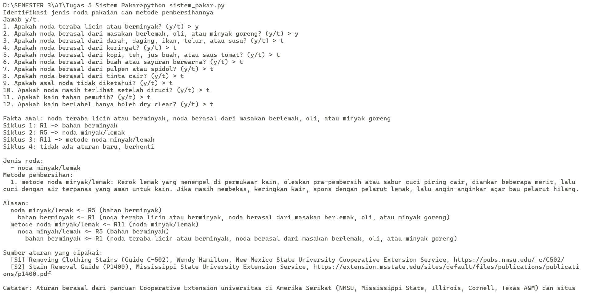
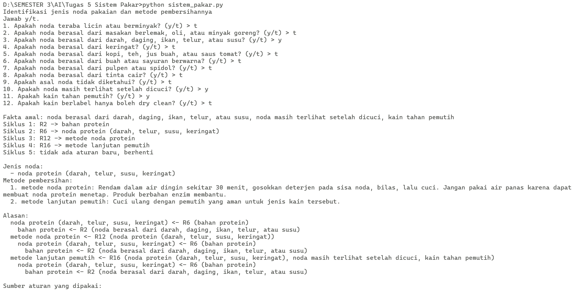
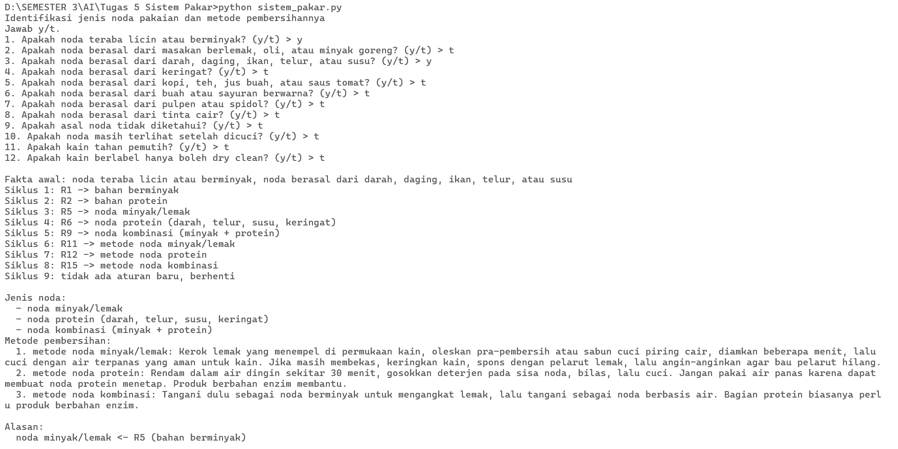
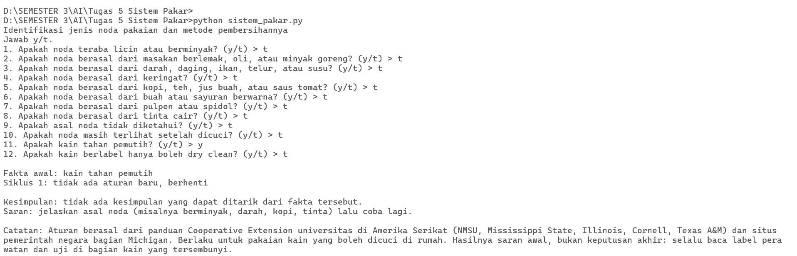

# Tugas 5 — Sistem Pakar Identifikasi Jenis Noda Pakaian dan Metode Pembersihannya

**Nama:** Baiq Nur Saqinah Kamila
**NIM:** F1D02510042
**Mata kuliah:** Kecerdasan Buatan

## 1. Topik dan cara menjalankan

Topik: mengidentifikasi jenis noda pada pakaian (minyak/lemak, protein, tanin, tinta, kombinasi, tidak dikenal) dari ciri-ciri yang dijawab pengguna, lalu menyarankan metode pembersihan beserta alasannya. Topik ini bukan kesehatan manusia.

| Berkas | Fungsi |
|---|---|
| `kb_noda.json` | Basis pengetahuan: 18 aturan IF-THEN, tiap aturan menunjuk sumber |
| `sistem_pakar.py` | Mesin inferensi forward chaining (ditulis sendiri, hanya library standar Python) |
| `uji_kasus.py` | Uji otomatis 6 kasus uji |
| `screenshot/` | Tangkapan layar keluaran program |

Bahasa: Python 3.8 ke atas, tanpa instalasi library tambahan.

```bash
python sistem_pakar.py                      # mode interaktif, jawab y/t
python sistem_pakar.py --ya "fakta1;fakta2" # mode otomatis (fakta persis seperti di kb_noda.json)
python uji_kasus.py                         # menjalankan semua kasus uji
```

## 2. Daftar sumber

Tanggal akses semua sumber: 13 November 2026.

| Kode | Sumber |
|---|---|
| S1 | Hamilton, W. *Removing Clothing Stains* (Guide C-502). New Mexico State University Cooperative Extension Service. https://pubs.nmsu.edu/_c/C502/ |
| S2 | *Stain Removal Guide* (P1400). Mississippi State University Extension Service. https://extension.msstate.edu/sites/default/files/publications/publications/p1400.pdf |
| S3 | Keiper, B. W. *Treatments Remove Frustrating Stains*. Mississippi State University Extension Service. https://extension.msstate.edu/node/19652 |
| S4 | *General Suggestions for Washable Fabrics*. University of Illinois Extension. https://dev.web.extension.illinois.edu/stain/general_fabrics.cfm |
| S5 | Price, J. L. dan Lemley, A. T. (2003). *Removing Stains at Home*. Cornell Cooperative Extension. https://hdl.handle.net/1813/3710 (rujukan pendukung: metode diuji di laboratorium, noda lama lebih sulit dihilangkan, tidak ada satu metode untuk semua noda) |
| S6 | Beard, A. V. (1989). *Removing Stains from Washable Fabrics* (B-1616). Texas Agricultural Extension Service, Texas A&M University System. https://core.ac.uk/download/147229781.pdf |
| S7 | *Tips for getting stains out of your laundry*. State of Michigan. https://www.michigan.gov/en/fyit/housing/tips-for-getting-stains-out-of-your-laundry |
| S8 | Mississippi State University Extension Service, halaman penanganan noda darah. https://extension.msstate.edu/node/7658 |

### Tabel aturan

Aturan berantai: fakta → bahan → jenis noda → metode (R1 → R5 → R11, dan seterusnya).

| Aturan | IF | THEN | Sumber |
|---|---|---|---|
| R1 | noda teraba licin/berminyak **ATAU** berasal dari masakan berlemak, oli, minyak goreng | bahan berminyak | S2 |
| R2 | noda dari darah, daging, ikan, telur, susu **ATAU** dari keringat | bahan protein | S3, S6 |
| R3 | noda dari kopi, teh, jus buah, saus tomat **ATAU** dari buah/sayuran berwarna | bahan tanin | S2, S6 |
| R4 | noda dari pulpen/spidol **ATAU** dari tinta cair | bahan tinta | S2, S7 |
| R5 | bahan berminyak | noda minyak/lemak | S2 |
| R6 | bahan protein | noda protein | S3, S6 |
| R7 | bahan tanin | noda tanin | S2, S6 |
| R8 | bahan tinta | noda tinta | S2, S7 |
| R9 | bahan berminyak **DAN** bahan protein | noda kombinasi | S2, S3 |
| R10 | asal noda tidak diketahui | noda tidak dikenal | S4 |
| R11 | noda minyak/lemak | metode: kerok, pra-pembersih/sabun cuci piring, cuci air terpanas yang aman; bila gagal, pelarut lemak | S1, S2 |
| R12 | noda protein | metode: rendam air dingin ±30 menit, deterjen, bilas, cuci; jangan air panas | S3, S4, S6, S8 |
| R13 | noda tanin | metode: air sejuk, deterjen cair, cuci; hindari amonia | S3, S6 |
| R14 | noda tinta | metode: spons alkohol gosok, bilas, pra-pembersih, cuci; jangan pakai susu | S1, S2, S7 |
| R15 | noda kombinasi | metode: tangani sebagai noda berminyak dulu, lalu sebagai noda berbasis air | S3 |
| R16 | noda protein **DAN** masih terlihat setelah dicuci **DAN** kain tahan pemutih | metode lanjutan: cuci ulang dengan pemutih yang aman untuk kain | S8 |
| R17 | noda tidak dikenal | metode: hindari air panas, uji di bagian tersembunyi | S4 |
| R18 | kain berlabel hanya boleh dry clean | peringatan: bawa ke binatu | S2, S1 |

Total ada 18 aturan dengan 6 jenis noda, 7 metode, dan 1 peringatan sebagai kesimpulan. Aturan R5 sampai R17 memakai hasil aturan lain.

## 3. Metode: Forward Chaining

Forward chaining dipilih karena pengguna biasanya mengetahui ciri-ciri yang terlihat (licin, asal noda, label kain) tetapi belum tahu jenis noda dan caranya. Pengetahuan mengalir dari fakta menuju kesimpulan, dan rantai aturan (fakta → bahan → jenis → metode) terlihat jelas pada bagian "Alasan".

Langkah mesin 
memori ← fakta yang dijawab "ya"
ULANGI:
    cocok ← aturan yang syaratnya terpenuhi oleh memori DAN hasilnya belum ada di memori
    JIKA cocok kosong: BERHENTI
    r ← cocok[0]
    tambahkan r.maka ke memori
    catat bahwa r.maka berasal dari r   # bahan "alasan"

Mode `dan` berarti semua syarat harus ada di memori, mode `atau` berarti salah satu cukup. Aturan yang hasilnya sudah ada di memori tidak dijalankan lagi sehingga program pasti berhenti. Alasan disusun dengan menelusuri mundur catatan asal tiap kesimpulan.

## 4. Kasus uji dan screenshot

| # | Jawaban "ya" | Kesimpulan yang diharapkan | Hasil |
|---|---|---|---|
| 1 | licin/berminyak, dari masakan berlemak/oli | noda minyak/lemak | sesuai |
| 2 | dari darah/daging/telur/susu, masih terlihat setelah dicuci, kain tahan pemutih | noda protein + metode lanjutan pemutih | sesuai |
| 3 | licin/berminyak, dari darah/daging/telur/susu | noda minyak, protein, dan kombinasi | sesuai |
| 4 | hanya kain tahan pemutih | tidak ada kesimpulan (kasus negatif) | sesuai |

Kasus tambahan di `uji_kasus.py`: tinta pulpen (noda tinta) dan asal noda tidak diketahui (noda tidak dikenal). Semua lulus.

**Kasus 1 — noda minyak**


**Kasus 2 — noda darah, masih membekas**


**Kasus 3 — noda kombinasi**


**Kasus 4 — tidak ada kesimpulan**


## 5. Batas keberlakuan

Pengetahuan dalam sistem ini diambil dari panduan Cooperative Extension beberapa universitas di Amerika Serikat dan situs pemerintah negara bagian Michigan, yang ditulis untuk pakaian kain yang boleh dicuci di rumah dengan produk yang lazim di sana. Produk, nama merek, dan jenis kain di Indonesia bisa berbeda, dan sistem ini belum mencakup sutra, kulit, atau bahan khusus lain. Hasilnya adalah saran awal, bukan keputusan akhir: selalu baca label perawatan pakaian dan uji bahan pembersih di bagian kain yang tersembunyi sebelum dipakai. Pernyataan ini juga ditampilkan di akhir keluaran program.

## 6. Penggunaan alat bantu AI

Dipakai: Claude (Anthropic) membantu menyusun draf aturan, kode, dan README ini. Saya telah membaca dan memahami kode serta aturannya, dan aturan sudah saya cocokkan dengan sumber S1 sampai S8 di atas.